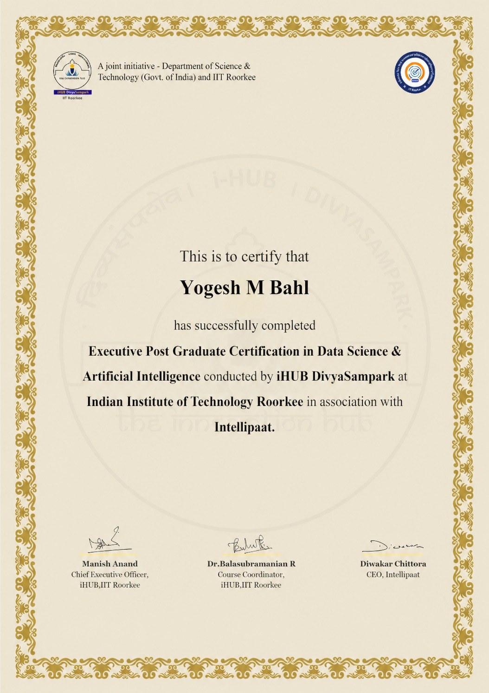

# Machine Learning, NLP & MLOps — IIT Roorkee Executive Program

My complete notes and hands-on work from the **IIT Roorkee Executive Program** in Machine Learning. It covers everything from drawing a straight line through data all the way to shipping a model with Docker, MLflow and CI/CD.

Every module has two parts:
- 📝 **Handwritten notes (PDF)**: the intuition and the math behind each algorithm
- 💻 **Practicals (Jupyter notebooks)**: the same algorithm built on a real dataset with scikit-learn


▶️ **Every notebook runs in Google Colab with one click. [Jump to the notebook list](#️-run-the-notebooks-in-google-colab).**

---

## 🎓 Program Completed

I completed the **Executive Post Graduate Certification in Data Science & Artificial Intelligence**, run by **iHUB DivyaSampark at IIT Roorkee** with Intellipaat. iHUB DivyaSampark is a joint initiative of the Department of Science & Technology (Govt. of India) and IIT Roorkee.

<p align="center">
  <a href="certificate/iit-roorkee-executive-pg-data-science-ai.jpg"></a>
</p>

---

## 🗺️ Learning Path

### 0. Live Classes
| # | Module | What's inside |
|---|--------|---------------|
| 001 | [IITR Live Classes](001-IITR-LiveClass) | Class practice notebooks for Python basics, NumPy, Pandas, Matplotlib, linear algebra, statistics and hypothesis testing, plus hands-on case studies (insurance claims, heart disease, Airbnb, retail purchases), class slides, reference books and datasets |

### 1. Foundations
| # | Module | What's inside |
|---|--------|---------------|
| 2 | [Introduction](2-Introduction) | AI vs ML vs DL vs Data Science, types of ML, instance-based vs model-based learning, lines and hyperplanes |

### 2. Supervised Learning: Regression
| # | Module | What's inside |
|---|--------|---------------|
| 3 | [Complete Linear Regression](3-Complete%20Linear%20Regression) | Simple, multiple and polynomial regression, OLS, MSE/RMSE/MAE, overfitting vs underfitting, handling imbalanced data |
| 4 | [Ridge, Lasso & ElasticNet](4-Ridge%20Lasso%20And%20Elasticnet) | Regularization and cross-validation types |
| 5 | [ML Project Lifecycle](5-Step%20By%20Step%20Project%20Implementation%20With%20LifeCycle%20Of%20ML%20Projects) | A step-by-step end-to-end project (Algerian forest fires) |

### 3. Supervised Learning: Classification
| # | Module | What's inside |
|---|--------|---------------|
| 6 | [Logistic Regression](6-Logistic%20Regression) | Binary and one-vs-rest classification, performance metrics |
| 7 | [Support Vector Machines](7-SVM) | SVC, SVR and kernels |
| 8 | [Naive Bayes](8-NAive%20Baye's) | Intuition, variants (Gaussian, Multinomial, Bernoulli), implementation |
| 9 | [K-Nearest Neighbors](9-K%20Nearest%20Neighbor) | KNN classifier and regressor, KD-Tree and Ball Tree |
| 10 | [Decision Trees](10-Decision%20Tree) | Classifier, regressor, splits on numerical features, diabetes prediction |

### 4. Ensemble Methods
| # | Module | What's inside |
|---|--------|---------------|
| 11 | [Random Forest](11-Random%20Forest) | Bagging, out-of-bag evaluation, classification and regression projects |
| 12 | [AdaBoost](12-Adaboost) | The math behind boosting, classification and regression |
| 13 | [Gradient Boosting](13-Gradient%20Boosting) | Car price regression and travel package classification |
| 14 | [XGBoost](14-XgBoost) | XGBoost classifier and regressor |

### 5. Unsupervised Learning
| # | Module | What's inside |
|---|--------|---------------|
| 15 | [Intro to Unsupervised ML](15-Unsupervised%20Machine%20Learning) | Overview of how learning works without labels |
| 16 | [PCA](16-PCA) | Dimensionality reduction |
| 17 | [K-Means](17-K%20Means%20Clutering%20Unsupervised%20ML) | K-Means and the elbow method |
| 18 | [Hierarchical Clustering](18-Hierarichal%20Clustering) | Dendrograms, K-Means vs hierarchical |
| 19 | [DBSCAN](19-DBSCAN%20Clustering) | Density-based clustering |
| 20 | [Silhouette Score](20-Silhoute%20Clustering) | Measuring how good a set of clusters is |
| 21 | [Anomaly Detection](21-Anomaly%20Detection%20ML) | Isolation Forest, Local Outlier Factor, DBSCAN on healthcare data |

### 6. NLP & Deep Learning
| # | Module | What's inside |
|---|--------|---------------|
| 26 | [Complete NLP for ML](26-CompleteNLP%20For%20Machine%20Learning) | Tokenization, stemming, lemmatization, stopwords, POS tagging, NER, Bag of Words, TF-IDF, Word2Vec |
| 27 | [Deep Learning (Bonus)](27-Deep%20Learning%20Bonus) | Neural networks, activation functions, loss functions, optimizers, weight initialization, CNNs |

### 7. MLOps & Deployment
| # | Module | What's inside |
|---|--------|---------------|
| 22 | [Docker](22-Dockers) | Containers and Docker Compose |
| 23 | [Git & GitHub](23-Git%20And%20Github) | Version control essentials |
| 24 | [End-to-End ML Project with Deployment](24-End%20To%20End%20ML%20Project%20With%20Deployment) | Student performance project deployed to Azure and AWS with CI/CD |
| 25 | [MLflow, DagsHub, BentoML & DVC](25-MLFlow%20Dagshub%20and%20BentoML-Complete%20ML%20Project%20Lifecycle) | Experiment tracking, model serving and data versioning |

---

## ⭐ Featured Projects

| Project | Technique | Where |
|---------|-----------|-------|
| 📧 **Spam vs Ham SMS Classifier** | TF-IDF, Word2Vec, AvgWord2Vec + ML | Module 26 |
| 📚 **Kindle Review Sentiment Analysis** | BoW, TF-IDF, Word2Vec | Module 26 |
| 🔥 **Algerian Forest Fire Prediction** | Ridge, Lasso, ElasticNet regression | Modules 3 & 5 |
| 🚗 **Used Car Price Prediction** (CarDekho) | Random Forest, AdaBoost, Gradient Boosting, XGBoost | Modules 11–14 |
| ✈️ **Holiday Package Purchase Prediction** | Ensemble classifiers with ROC-AUC | Modules 11–14 |
| 🩺 **Diabetes Prediction** | Decision Tree Regressor | Module 10 |
| 🏥 **Healthcare Anomaly Detection** | Isolation Forest, LOF, DBSCAN | Module 21 |
| 🎓 **Student Performance Predictor** | End-to-end pipeline, deployed on Azure and AWS | Module 24 |

---

## 🛠️ Tech Stack

- **Language:** Python
- **Data and visuals:** pandas, NumPy, Matplotlib, Seaborn, Plotly
- **Machine learning:** scikit-learn, XGBoost, statsmodels
- **NLP:** NLTK, spaCy, Gensim (Word2Vec)
- **MLOps:** MLflow, DagsHub, BentoML, DVC, Docker, GitHub Actions, AWS, Azure

---

## ▶️ Run the Notebooks in Google Colab

Click any **Open in Colab** button to run that notebook in your browser with nothing to install. Datasets load straight from this repo, so there's nothing to upload. In Colab, choose **Runtime → Run all**.

**001 · IITR Live Classes** (Python, NumPy, Pandas, Statistics and hands-on case studies from the live sessions)

<details><summary><b>Python Basics</b> (6 notebooks)</summary>

| Notebook | Run |
|---|---|
| Basic Python | [](https://colab.research.google.com/github/yogeshkbahl/IIT-Roorkee-ExecutiveProgram/blob/main/001-IITR-LiveClass/LivePython-Basic-280724-ClassPractice-BasicPython.ipynb) |
| Lists & Functions | [](https://colab.research.google.com/github/yogeshkbahl/IIT-Roorkee-ExecutiveProgram/blob/main/001-IITR-LiveClass/LivePython-Basic-280724-ClassPractice-List.ipynb) |
| Tuples | [](https://colab.research.google.com/github/yogeshkbahl/IIT-Roorkee-ExecutiveProgram/blob/main/001-IITR-LiveClass/LivePython-Basic-280724-ClassPractice-Tuple.ipynb) |
| Sets | [](https://colab.research.google.com/github/yogeshkbahl/IIT-Roorkee-ExecutiveProgram/blob/main/001-IITR-LiveClass/LivePython-Basic-280724-ClassPractice-Set.ipynb) |
| Dictionaries | [](https://colab.research.google.com/github/yogeshkbahl/IIT-Roorkee-ExecutiveProgram/blob/main/001-IITR-LiveClass/LivePython-Basic-280724-ClassPractice-Dictionary.ipynb) |
| File Handling | [](https://colab.research.google.com/github/yogeshkbahl/IIT-Roorkee-ExecutiveProgram/blob/main/001-IITR-LiveClass/LivePython-Basic-280724-ClassPractice-FileHandling.ipynb) |

</details>

<details><summary><b>NumPy</b> (5 notebooks)</summary>

| Notebook | Run |
|---|---|
| NumPy Day 1 | [](https://colab.research.google.com/github/yogeshkbahl/IIT-Roorkee-ExecutiveProgram/blob/main/001-IITR-LiveClass/IITR%20Documentation/notebooks/Numpy_day_1.ipynb) |
| NumPy Part 1 | [](https://colab.research.google.com/github/yogeshkbahl/IIT-Roorkee-ExecutiveProgram/blob/main/001-IITR-LiveClass/LivePython-Basic-280724-ClassPractice-Numpy-Part1.ipynb) |
| NumPy Part 1 (EPGC) | [](https://colab.research.google.com/github/yogeshkbahl/IIT-Roorkee-ExecutiveProgram/blob/main/001-IITR-LiveClass/LivePython-Basic-242007-ClassPractice-Numpy-Part1-EPGC.ipynb) |
| NumPy Part 2 | [](https://colab.research.google.com/github/yogeshkbahl/IIT-Roorkee-ExecutiveProgram/blob/main/001-IITR-LiveClass/LivePython-Basic-280724-ClassPractice-Numpy-Part2.ipynb) |
| NumPy Part 2 Hands-on (EPGC) | [](https://colab.research.google.com/github/yogeshkbahl/IIT-Roorkee-ExecutiveProgram/blob/main/001-IITR-LiveClass/LivePython-Basic-242007-Handson-Numpy-Part2-EPGC.ipynb) |

</details>

<details><summary><b>Pandas</b> (5 notebooks)</summary>

| Notebook | Run |
|---|---|
| Pandas Day 1 | [](https://colab.research.google.com/github/yogeshkbahl/IIT-Roorkee-ExecutiveProgram/blob/main/001-IITR-LiveClass/IITR%20Documentation/notebooks/Pandas_day_1.ipynb) |
| Pandas Day 2 | [](https://colab.research.google.com/github/yogeshkbahl/IIT-Roorkee-ExecutiveProgram/blob/main/001-IITR-LiveClass/IITR%20Documentation/notebooks/Pandas_Day_2.ipynb) |
| Pandas Part 1 | [](https://colab.research.google.com/github/yogeshkbahl/IIT-Roorkee-ExecutiveProgram/blob/main/001-IITR-LiveClass/LivePython-Basic-280724-ClassPractice-Pandas-Part1.ipynb) |
| Pandas: W3Schools Exercises | [](https://colab.research.google.com/github/yogeshkbahl/IIT-Roorkee-ExecutiveProgram/blob/main/001-IITR-LiveClass/LivePython-Basic-280724-W3-Pandas-Part1.ipynb) |
| Pandas (EPGC) | [](https://colab.research.google.com/github/yogeshkbahl/IIT-Roorkee-ExecutiveProgram/blob/main/001-IITR-LiveClass/LivePython-Basic-242007-ClassPractice-Pandas-EPGC.ipynb) |

</details>

<details><summary><b>Visualization & Linear Algebra</b> (3 notebooks)</summary>

| Notebook | Run |
|---|---|
| Matplotlib | [](https://colab.research.google.com/github/yogeshkbahl/IIT-Roorkee-ExecutiveProgram/blob/main/001-IITR-LiveClass/IITR%20Documentation/notebooks/Matplotlib.ipynb) |
| Linear Algebra | [](https://colab.research.google.com/github/yogeshkbahl/IIT-Roorkee-ExecutiveProgram/blob/main/001-IITR-LiveClass/IITR%20Documentation/Dataset/Linear%20Algebra.ipynb) |
| Linear Algebra 1 | [](https://colab.research.google.com/github/yogeshkbahl/IIT-Roorkee-ExecutiveProgram/blob/main/001-IITR-LiveClass/IITR%20Documentation/PowerPoint%20Presentations/Linear%20Algebra/Linear_Algebra-1/Linear_Algebra%20%281%29.ipynb) |

</details>

<details><summary><b>Statistics & Probability</b> (7 notebooks)</summary>

| Notebook | Run |
|---|---|
| Stats Basics: Day 1 | [](https://colab.research.google.com/github/yogeshkbahl/IIT-Roorkee-ExecutiveProgram/blob/main/001-IITR-LiveClass/IITR%20Documentation/PowerPoint%20Presentations/Stats/Stats_Basic_Day_1_20th_Oct.ipynb) |
| Stats Basics: Days 1–3 | [](https://colab.research.google.com/github/yogeshkbahl/IIT-Roorkee-ExecutiveProgram/blob/main/001-IITR-LiveClass/IITR%20Documentation/notebooks/Stats_Basic_Day_1_and_2%2C3_27th_Oct.ipynb) |
| Statistics Class 1 | [](https://colab.research.google.com/github/yogeshkbahl/IIT-Roorkee-ExecutiveProgram/blob/main/001-IITR-LiveClass/LivePython-Basic-242007-ClassPractice-Statistics_Class1.ipynb) |
| Statistics Class 3 Hands-on | [](https://colab.research.google.com/github/yogeshkbahl/IIT-Roorkee-ExecutiveProgram/blob/main/001-IITR-LiveClass/Live%20Python-240510-ClassPractice-Statistics_Class3%20Handson.ipynb) |
| Stats & Probability Hands-on | [](https://colab.research.google.com/github/yogeshkbahl/IIT-Roorkee-ExecutiveProgram/blob/main/001-IITR-LiveClass/IITR%20Documentation/notebooks/19_01_2025_Stats_and_Prob_handson_by_tanmay.ipynb) |
| Hypothesis Testing (Feb 8) | [](https://colab.research.google.com/github/yogeshkbahl/IIT-Roorkee-ExecutiveProgram/blob/main/001-IITR-LiveClass/IITR%20Documentation/PowerPoint%20Presentations/Stats/08Feb2025-PythonFile-RudraClass.ipynb) |
| Hypothesis Testing (Feb 9) | [](https://colab.research.google.com/github/yogeshkbahl/IIT-Roorkee-ExecutiveProgram/blob/main/001-IITR-LiveClass/IITR%20Documentation/PowerPoint%20Presentations/Stats/09Feb2025-PythonFile-RudraClass.ipynb) |

</details>

<details><summary><b>ML Hands-on & Case Studies</b> (4 notebooks)</summary>

| Notebook | Run |
|---|---|
| Linear Regression: Insurance Claims | [](https://colab.research.google.com/github/yogeshkbahl/IIT-Roorkee-ExecutiveProgram/blob/main/001-IITR-LiveClass/IITR%20Documentation/PowerPoint%20Presentations/ML_LinearRegression%2022Feb-16MarClasses/Linear%20Regression%20Hands%20On%2001032025/01032025.ipynb) |
| Decision Tree: Heart Disease | [](https://colab.research.google.com/github/yogeshkbahl/IIT-Roorkee-ExecutiveProgram/blob/main/001-IITR-LiveClass/IITR%20Documentation/PowerPoint%20Presentations/Decision%20Tree/Decision_tree_Handson.ipynb) |
| Case Study: Airbnb | [](https://colab.research.google.com/github/yogeshkbahl/IIT-Roorkee-ExecutiveProgram/blob/main/001-IITR-LiveClass/IITR%20Documentation/notebooks/25_01_2025_AirB%26B_case_study_by_Tanmay.ipynb) |
| Case Study: Retail Purchase Data | [](https://colab.research.google.com/github/yogeshkbahl/IIT-Roorkee-ExecutiveProgram/blob/main/001-IITR-LiveClass/IITR%20Documentation/PowerPoint%20Presentations/Stats/Case_Study_Purchase_Data_Harsh%20-%20Harshit%20Trivedi.ipynb) |

</details>

**3 · Complete Linear Regression**

| Notebook | Run |
|---|---|
| Handling Imbalance Dataset | [](https://colab.research.google.com/github/yogeshkbahl/IIT-Roorkee-ExecutiveProgram/blob/main/3-Complete%20Linear%20Regression/Practicals/2.0-Handling%20Imbalance%20Dataset.ipynb) |
| Linear Regression ML Implementation | [](https://colab.research.google.com/github/yogeshkbahl/IIT-Roorkee-ExecutiveProgram/blob/main/3-Complete%20Linear%20Regression/Practicals/Linear%20Regression%20ML%20Implementation.ipynb) |
| Linear Regression Practicals | [](https://colab.research.google.com/github/yogeshkbahl/IIT-Roorkee-ExecutiveProgram/blob/main/3-Complete%20Linear%20Regression/Practicals/Linear%20Regression%20Practicals.ipynb) |
| Model Training | [](https://colab.research.google.com/github/yogeshkbahl/IIT-Roorkee-ExecutiveProgram/blob/main/3-Complete%20Linear%20Regression/Practicals/Model%20Training.ipynb) |
| Multiple Linear Regression- Economics Dataset | [](https://colab.research.google.com/github/yogeshkbahl/IIT-Roorkee-ExecutiveProgram/blob/main/3-Complete%20Linear%20Regression/Practicals/Multiple%20Linear%20Regression-%20Economics%20Dataset.ipynb) |
| Polynomial Regression Implementation | [](https://colab.research.google.com/github/yogeshkbahl/IIT-Roorkee-ExecutiveProgram/blob/main/3-Complete%20Linear%20Regression/Practicals/Polynomial%20Regression%20Implementation.ipynb) |
| Practical Simple Linear Regression | [](https://colab.research.google.com/github/yogeshkbahl/IIT-Roorkee-ExecutiveProgram/blob/main/3-Complete%20Linear%20Regression/Practicals/Practical%20Simple%20Linear%20Regression.ipynb) |
| Polynomial Regression Implementation (Regression Projects folder) | [](https://colab.research.google.com/github/yogeshkbahl/IIT-Roorkee-ExecutiveProgram/blob/main/3-Complete%20Linear%20Regression/Practicals/Regression%20Projects/Polynomial%20Regression%20Implementation.ipynb) |
| Practical Simple Linear Regression (Regression Projects folder) | [](https://colab.research.google.com/github/yogeshkbahl/IIT-Roorkee-ExecutiveProgram/blob/main/3-Complete%20Linear%20Regression/Practicals/Regression%20Projects/Practical%20Simple%20Linear%20Regression.ipynb) |
| Ridge, Lasso Regression | [](https://colab.research.google.com/github/yogeshkbahl/IIT-Roorkee-ExecutiveProgram/blob/main/3-Complete%20Linear%20Regression/Practicals/Ridge%2C%20Lasso%20Regression.ipynb) |
| Simple Linear Regression | [](https://colab.research.google.com/github/yogeshkbahl/IIT-Roorkee-ExecutiveProgram/blob/main/3-Complete%20Linear%20Regression/Practicals/simple%20linear%20regression.ipynb) |

**4 · Ridge Lasso And Elasticnet**

| Notebook | Run |
|---|---|
| Model Training | [](https://colab.research.google.com/github/yogeshkbahl/IIT-Roorkee-ExecutiveProgram/blob/main/4-Ridge%20Lasso%20And%20Elasticnet/Ridge%20Lassso%20Elastic%20Regression%20Practicals/Model%20Training.ipynb) |
| Ridge, Lasso Regression | [](https://colab.research.google.com/github/yogeshkbahl/IIT-Roorkee-ExecutiveProgram/blob/main/4-Ridge%20Lasso%20And%20Elasticnet/Ridge%20Lassso%20Elastic%20Regression%20Practicals/Ridge%2C%20Lasso%20Regression.ipynb) |

**5 · Step By Step Project Implementation With LifeCycle Of ML Projects**

| Notebook | Run |
|---|---|
| Simple Linear Regression | [](https://colab.research.google.com/github/yogeshkbahl/IIT-Roorkee-ExecutiveProgram/blob/main/5-Step%20By%20Step%20Project%20Implementation%20With%20LifeCycle%20Of%20ML%20Projects/3.0-Simple%20Linear%20Regression.ipynb) |
| Multiple Linear Regression | [](https://colab.research.google.com/github/yogeshkbahl/IIT-Roorkee-ExecutiveProgram/blob/main/5-Step%20By%20Step%20Project%20Implementation%20With%20LifeCycle%20Of%20ML%20Projects/4.0-Multiple%20Linear%20Regression.ipynb) |

**6 · Logistic Regression**

| Notebook | Run |
|---|---|
| Logistic Regression Implementation | [](https://colab.research.google.com/github/yogeshkbahl/IIT-Roorkee-ExecutiveProgram/blob/main/6-Logistic%20Regression/Logistic%20Practicals/Logistic%20Regression%20Implementation.ipynb) |

**7 · SVM**

| Notebook | Run |
|---|---|
| Basic SVC Implementation | [](https://colab.research.google.com/github/yogeshkbahl/IIT-Roorkee-ExecutiveProgram/blob/main/7-SVM/Practicals/Basic%20SVC%20Implementation.ipynb) |
| SVM Kernels Implementation | [](https://colab.research.google.com/github/yogeshkbahl/IIT-Roorkee-ExecutiveProgram/blob/main/7-SVM/Practicals/SVM%20Kernels%20Implementation.ipynb) |
| Support Vector Regression Implementation | [](https://colab.research.google.com/github/yogeshkbahl/IIT-Roorkee-ExecutiveProgram/blob/main/7-SVM/Practicals/Support%20Vector%20Regression%20Implementation.ipynb) |

**8 · NAive Baye's**

| Notebook | Run |
|---|---|
| Naive Bayes Implementation | [](https://colab.research.google.com/github/yogeshkbahl/IIT-Roorkee-ExecutiveProgram/blob/main/8-NAive%20Baye%27s/Handwritten%20Notes/3.0-Naive%20Bayes%20Implementation.ipynb) |

**9 · K Nearest Neighbor**

| Notebook | Run |
|---|---|
| KNNClassifier | [](https://colab.research.google.com/github/yogeshkbahl/IIT-Roorkee-ExecutiveProgram/blob/main/9-K%20Nearest%20Neighbor/3.0-KNNClassifier.ipynb) |
| KNNRegressor | [](https://colab.research.google.com/github/yogeshkbahl/IIT-Roorkee-ExecutiveProgram/blob/main/9-K%20Nearest%20Neighbor/3.0-KNNRegressor.ipynb) |

**10 · Decision Tree**

| Notebook | Run |
|---|---|
| Decision Tree Classifier Practical Implementation | [](https://colab.research.google.com/github/yogeshkbahl/IIT-Roorkee-ExecutiveProgram/blob/main/10-Decision%20Tree/Project/Decision%20Tree%20Classifier%20Practical%20Implementation.ipynb) |
| Diabetes Prediction Using Decision Tree Regressor | [](https://colab.research.google.com/github/yogeshkbahl/IIT-Roorkee-ExecutiveProgram/blob/main/10-Decision%20Tree/Project/Diabetes%20Prediction%20Using%20Decision%20Tree%20Regressor.ipynb) |

**11 · Random Forest**

| Notebook | Run |
|---|---|
| Random Forest Classification Implementation | [](https://colab.research.google.com/github/yogeshkbahl/IIT-Roorkee-ExecutiveProgram/blob/main/11-Random%20Forest/Projects/Classification/Random%20Forest%20Classification%20Implementation.ipynb) |
| Random Forest Regression Implementation | [](https://colab.research.google.com/github/yogeshkbahl/IIT-Roorkee-ExecutiveProgram/blob/main/11-Random%20Forest/Projects/Regression/Random%20Forest%20Regression%20Implementation.ipynb) |

**12 · Adaboost**

| Notebook | Run |
|---|---|
| Adaboost Classification Implementation | [](https://colab.research.google.com/github/yogeshkbahl/IIT-Roorkee-ExecutiveProgram/blob/main/12-Adaboost/Projects/Projects/Adaboost%20Classification%20Implementation.ipynb) |
| Adaboost Regression Implementation | [](https://colab.research.google.com/github/yogeshkbahl/IIT-Roorkee-ExecutiveProgram/blob/main/12-Adaboost/Projects/Projects/Adaboost%20Regression%20Implementation.ipynb) |

**13 · Gradient Boosting**

| Notebook | Run |
|---|---|
| GradientBoost Classification Implementation | [](https://colab.research.google.com/github/yogeshkbahl/IIT-Roorkee-ExecutiveProgram/blob/main/13-Gradient%20Boosting/Projects/Classification/GradientBoost%20Classification%20Implementation.ipynb) |
| Gradientboost Regression Implementation | [](https://colab.research.google.com/github/yogeshkbahl/IIT-Roorkee-ExecutiveProgram/blob/main/13-Gradient%20Boosting/Projects/Regression/Gradientboost%20Regression%20Implementation.ipynb) |

**14 · XgBoost**

| Notebook | Run |
|---|---|
| XgboostBoost Classification Implementation | [](https://colab.research.google.com/github/yogeshkbahl/IIT-Roorkee-ExecutiveProgram/blob/main/14-XgBoost/Project/XGboost%20Classifier/XgboostBoost%20Classification%20Implementation.ipynb) |
| Xgboost Regression Implementation | [](https://colab.research.google.com/github/yogeshkbahl/IIT-Roorkee-ExecutiveProgram/blob/main/14-XgBoost/Project/Xgboosst%20Regressor/Xgboost%20Regression%20Implementation.ipynb) |

**16 · PCA**

| Notebook | Run |
|---|---|
| Principal Component Analysis (PCA) Implementation | [](https://colab.research.google.com/github/yogeshkbahl/IIT-Roorkee-ExecutiveProgram/blob/main/16-PCA/PCA%20Project/Principal%20Component%20Analysis%20%28PCA%29%20Implementation.ipynb) |

**17 · K Means Clutering Unsupervised ML**

| Notebook | Run |
|---|---|
| K Means Clustering Algorithms implementation | [](https://colab.research.google.com/github/yogeshkbahl/IIT-Roorkee-ExecutiveProgram/blob/main/17-K%20Means%20Clutering%20Unsupervised%20ML/K%20Means%20Clustering%20Algorithms%20implementation.ipynb) |

**18 · Hierarichal Clustering**

| Notebook | Run |
|---|---|
| Hierarichal Clustering Implementation | [](https://colab.research.google.com/github/yogeshkbahl/IIT-Roorkee-ExecutiveProgram/blob/main/18-Hierarichal%20Clustering/Hierarichal%20Clustering%20Implementation.ipynb) |

**19 · DBSCAN Clustering**

| Notebook | Run |
|---|---|
| DBSCAN Implementation | [](https://colab.research.google.com/github/yogeshkbahl/IIT-Roorkee-ExecutiveProgram/blob/main/19-DBSCAN%20Clustering/DBSCAN%20Implementation.ipynb) |

**21 · Anomaly Detection ML**

| Notebook | Run |
|---|---|
| DBSCAN Implementation | [](https://colab.research.google.com/github/yogeshkbahl/IIT-Roorkee-ExecutiveProgram/blob/main/21-Anomaly%20Detection%20ML/DBSCAN%20Implementation%20%281%29.ipynb) |
| Isolation Anamoly Detection | [](https://colab.research.google.com/github/yogeshkbahl/IIT-Roorkee-ExecutiveProgram/blob/main/21-Anomaly%20Detection%20ML/Isolation%20Anamoly%20Detection.ipynb) |

**26 · CompleteNLP For Machine Learning**

| Notebook | Run |
|---|---|
| Bag Of Words Practical's | [](https://colab.research.google.com/github/yogeshkbahl/IIT-Roorkee-ExecutiveProgram/blob/main/26-CompleteNLP%20For%20Machine%20Learning/Practicals/15-Bag%20Of%20Words%20Practical%27s.ipynb) |
| TF-IDF Practical | [](https://colab.research.google.com/github/yogeshkbahl/IIT-Roorkee-ExecutiveProgram/blob/main/26-CompleteNLP%20For%20Machine%20Learning/Practicals/16-TF-IDF%20Practical.ipynb) |
| Word2vec_Practical_Implementation | [](https://colab.research.google.com/github/yogeshkbahl/IIT-Roorkee-ExecutiveProgram/blob/main/26-CompleteNLP%20For%20Machine%20Learning/Practicals/26-Word2vec_Practical_Implementation.ipynb) |
| Spam Ham Classification Project Using TF-IDF And ML | [](https://colab.research.google.com/github/yogeshkbahl/IIT-Roorkee-ExecutiveProgram/blob/main/26-CompleteNLP%20For%20Machine%20Learning/Practicals/27-Spam%20Ham%20Classification%20Project%20Using%20TF-IDF%20And%20ML.ipynb) |
| Spam Ham Projects Using Word2vec,AvgWord2vec | [](https://colab.research.google.com/github/yogeshkbahl/IIT-Roorkee-ExecutiveProgram/blob/main/26-CompleteNLP%20For%20Machine%20Learning/Practicals/28%20And%2029%20-Spam%20Ham%20Projects%20Using%20Word2vec%2CAvgWord2vec.ipynb) |
| and 31-Project 2- Kindle Review Sentiment Analyis | [](https://colab.research.google.com/github/yogeshkbahl/IIT-Roorkee-ExecutiveProgram/blob/main/26-CompleteNLP%20For%20Machine%20Learning/Practicals/30%20and%2031-Project%202-%20Kindle%20Review%20Sentiment%20Analyis.ipynb) |
| Tokenization Example Using NLTK | [](https://colab.research.google.com/github/yogeshkbahl/IIT-Roorkee-ExecutiveProgram/blob/main/26-CompleteNLP%20For%20Machine%20Learning/Practicals/4-Tokenization%20Example%20Using%20NLTK.ipynb) |
| Stemming And Its Types- Text Preprocessing | [](https://colab.research.google.com/github/yogeshkbahl/IIT-Roorkee-ExecutiveProgram/blob/main/26-CompleteNLP%20For%20Machine%20Learning/Practicals/5-Stemming%20And%20Its%20Types-%20Text%20Preprocessing.ipynb) |
| Lemmatization- Text Preprocessing | [](https://colab.research.google.com/github/yogeshkbahl/IIT-Roorkee-ExecutiveProgram/blob/main/26-CompleteNLP%20For%20Machine%20Learning/Practicals/6-Lemmatization-%20Text%20Preprocessing.ipynb) |
| Text Preprocessing-Stopwords With NLTK | [](https://colab.research.google.com/github/yogeshkbahl/IIT-Roorkee-ExecutiveProgram/blob/main/26-CompleteNLP%20For%20Machine%20Learning/Practicals/7-Text%20Preprocessing-Stopwords%20With%20NLTK.ipynb) |
| Parts Of Speech Tagging | [](https://colab.research.google.com/github/yogeshkbahl/IIT-Roorkee-ExecutiveProgram/blob/main/26-CompleteNLP%20For%20Machine%20Learning/Practicals/8-Parts%20Of%20Speech%20Tagging.ipynb) |
| Named Entity Recognition | [](https://colab.research.google.com/github/yogeshkbahl/IIT-Roorkee-ExecutiveProgram/blob/main/26-CompleteNLP%20For%20Machine%20Learning/Practicals/9-Named%20Entity%20Recognition.ipynb) |

> **Large datasets not stored here:** GitHub caps files at 100 MB, so three public datasets from the live classes are left out. Download them from Kaggle if you need them: [Credit Card Fraud](https://www.kaggle.com/datasets/mlg-ulb/creditcardfraud) (`creditcard.csv`), [Netflix Prize](https://www.kaggle.com/datasets/netflix-inc/netflix-prize-data) (`combined_data_*.txt`) and [News Category](https://www.kaggle.com/datasets/rmisra/news-category-dataset) (`News_Category_Dataset_v3.json`). Class recordings are also kept off GitHub.

> **Note:** The two Word2Vec notebooks download Google's 1.6 GB pretrained model, so their first run takes a few minutes. The ensemble notebooks (modules 11–14) run large hyperparameter searches and can take 10+ minutes.

---

## 💻 Run It Locally

```bash
# 1. Clone the repo
git clone https://github.com/yogeshkbahl/IIT-Roorkee-ExecutiveProgram.git
cd IIT-Roorkee-ExecutiveProgram

# 2. Create a virtual environment (optional but recommended)
python -m venv venv
source venv/bin/activate        # Windows: venv\Scripts\activate

# 3. Install the main libraries
pip install jupyter pandas numpy matplotlib seaborn plotly scikit-learn xgboost statsmodels nltk spacy gensim

# 4. Launch Jupyter and open any notebook
jupyter notebook
```

> **Tip:** Each notebook reads its dataset from the same folder, so open notebooks from inside their module folder. Some NLP notebooks also need `nltk.download(...)` to run once.

The `.zip` files in modules 5, 22, 24 and 25 are full standalone projects. Unzip them to explore the code.

---

## 📂 Repo Structure

```
IIT-Roorkee-ExecutiveProgram/
├── 001-IITR-LiveClass/                ← live-class notebooks, slides, books, datasets
├── 2-Introduction/
├── 3-Complete Linear Regression/
│   ├── Regression Handwritten Notes/   ← PDFs (theory)
│   └── Practicals/                     ← notebooks + datasets
├── ...                                 ← one folder per topic (modules 4–27)
├── LICENSE
└── README.md
```

---

## 🙌 Acknowledgements

The course content and materials come from the **IIT Roorkee Executive Program**. This repo is my personal record of working through it.

## 📄 License

[MIT](LICENSE)
